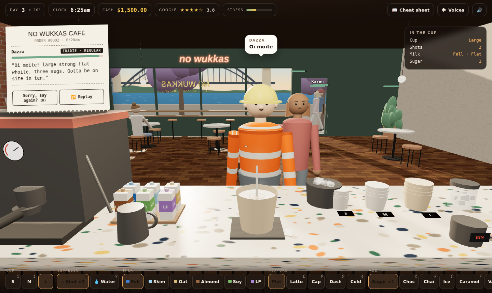

# No Wukkas Café ☕🇦🇺

> Decode the accent. Survive the Karens. Pull the perfect flattie. Buy the Mosman harbour-front.

A first-person 3D café sim set in Surry Hills, Sydney. You stand behind the counter while a very Australian queue orders at you:

> *"Oi moite! Lahj strawng flattie, sugar? Nah yeah, three. Gotta be on site in ten."*

Work out what they actually said, make it right, and do it before their patience runs out. By 2 pm the day's receipt prints: rent, wages, beans and milk, the ATO. Whatever's left buys upgrades, a ute, a terrace, and one day a harbour-front in Mosman.



## Status

| | |
|---|---|
| **Stage** | Day 1 barista trial playable in `src/` (Vite + TypeScript + Three.js) |
| **Day 1** | Job trial at No Wukkas: grind, pull a shot, steam milk, pour a latte-art heart while Gaz the owner judges you. Three goes |
| **Prototype** | [`prototype/game.html`](prototype/game.html): single file, Three.js r128 via CDN; reference for the customer + economy loop |
| **Next** | Playtest the trial, then port the customer day from the prototype (Roadmap Phase 0) |

See [`docs/ROADMAP.md`](docs/ROADMAP.md) for the full plan.

## What's in the game (prototype)

- **First-person counter view** with mouse head-look (drag on touch) and clickable stations: grinder, group heads, steam wand, milk cartons, cup stacks, sugar/choc/chai/syrups, ice, bin, bell.
- **16 drinks** from flat white to magic, piccolo, long mac and dirty chai, unlocking over the first four days.
- **Accent decoding:** orders are generated in Aussie English with slang and phonetic accents that get thicker every day. "Sorry, say again?" gives a plain version at a patience cost. A slang dictionary fills in as you hear new words.
- **A recurring cast:** Dazza the tradie, Nan Beryl, Jiwoo on a working holiday (아아!), Wei with a group order before his COMP exam, Aunty Linh, Priya after night shift, and the difficult ones: Karen, an influencer, a real-estate agent, a laptop camper. Regulars start ordering "the usual".
- **Events:** complaint showdowns, an EFTPOS outage, a council health inspection, and bin chickens (ibises) raiding the banana bread.
- **Economy and life sim:** a daily P&L receipt, rent hikes, weekly BAS, stress and burnout, café upgrades, branches from Bondi to Gangnam, cars, and property with a 20% deposit, stamp duty and mortgage repayments.

## Getting started (macOS)

### Prerequisites

```bash
xcode-select --install                     # git + build tools
/bin/bash -c "$(curl -fsSL https://raw.githubusercontent.com/Homebrew/install/HEAD/install.sh)"
brew install fnm                           # Node version manager
fnm install 24 && fnm default 24           # Node 24 LTS
node -v                                    # v24.x
```

AI tooling (optional but assumed by the docs): **Claude Code** for implementation, **Codex** for review. See [AGENTS.md](AGENTS.md) and [CLAUDE.md](CLAUDE.md).

### Run the prototype right now

```bash
npx serve prototype
# open http://localhost:3000/game.html (needs internet for the Three.js CDN)
```

### Run the real project

```bash
npm install
npm run dev            # http://localhost:5173
npm test               # unit tests
npm run balance        # 30-day economy simulation → reports/balance.csv
```

Full command list: [AGENTS.md §3](AGENTS.md#3-commands).

### Test on your iPhone

1. `npm run dev -- --host` and open the printed network URL on the iPhone (same Wi-Fi).
2. On the iPhone: **Settings → Apps → Safari → Advanced → Web Inspector** on.
3. On the Mac: **Safari → Settings → Advanced → "Show features for web developers"**, then **Develop → [your iPhone] → the page** to get the console and debugger.

## Project structure (target)

```
no-wukkas-cafe/
├─ AGENTS.md            shared rules for AI agents (Codex reads this)
├─ CLAUDE.md            implementer notes for Claude Code (imports AGENTS.md)
├─ README.md
├─ docs/
│  └─ ROADMAP.md        phases, tasks, success metrics
├─ prototype/
│  └─ game.html         original single-file demo (design reference, read-only)
├─ src/
│  ├─ core/             state machine, clock, seeded RNG, save/load
│  ├─ sim/              pure game logic (unit-tested, runs in Node)
│  ├─ data/             drinks, slang, cast, events, shop: content as data
│  ├─ world/            Three.js scene, café, humans, cup, picking
│  ├─ audio/            SFX + voice
│  └─ ui/               HUD, docket, modals, shop
├─ scripts/balance.ts
├─ tests/
└─ public/assets/
```

## Tech stack

Vite · TypeScript (strict) · Three.js · Vitest · Playwright. Static build, deployable to any static host (Vercel, Netlify, GitHub Pages, Cloudflare Pages).

## Kickoff: your first Claude Code session

From the repo root:

```bash
git init && git add -A && git commit -m "chore: project docs + prototype"
claude
```

Then paste:

> Read AGENTS.md, CLAUDE.md and docs/ROADMAP.md. Start Phase 0, task 0.1: scaffold the Vite + TypeScript project with the exact npm scripts from AGENTS.md §3, strict tsconfig, ESLint + Prettier, Vitest and Playwright. Don't port any game code yet. Show me the plan in Korean first.

## Licence

TBD. Choose before making the repo public (MIT for code is a common default; audio and art assets may need separate terms).
