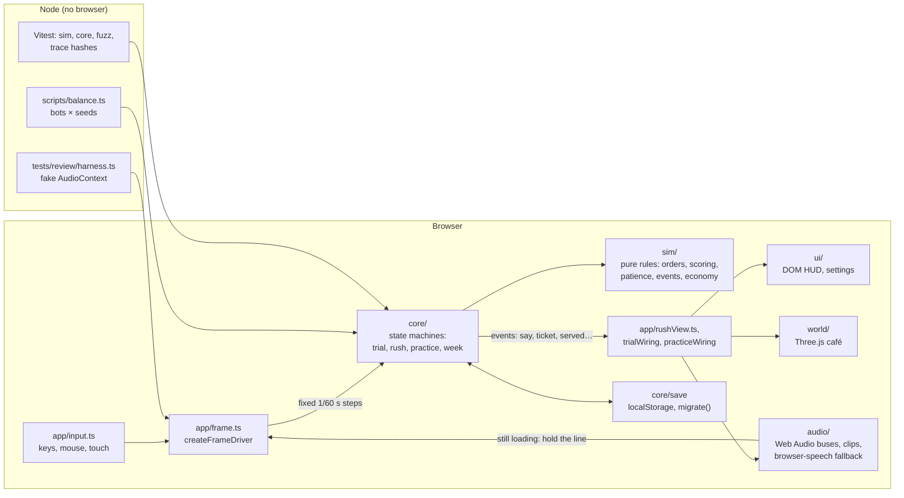

# Devlog: how No Wukkas Café is built

Draft, 2026-10-18 (overnight run #3, B5). Architecture only, from the code as it is on `main`. No playtest learnings
yet: Phase 5 (people playing it) hasn't happened.

## The shape of it

A first-person café sim in the browser: Vite + TypeScript (strict) + Three.js, no backend. The code is split so that
everything that decides what happens can run without a browser.

## Pure sim, enforced

`src/sim/` holds the game's rules and imports nothing from `world/`, `ui/`, `audio/` or `three`, and never touches
`window`, `document`, timers, `Date.now` or `Math.random`. ESLint enforces it, and `tests/lint/simPurity.test.ts`
checks the lint rules themselves, so a config edit can't quietly switch them off. `src/core/` gets the same timer ban.
A step takes the state and the player's input and updates the state, leaving a list of events; the view reads the
events (a line to say, a ticket printed, a drink served) and never writes sim state back.

## One seeded random source

`src/core/rng.ts` is the only randomness in the game: mulberry32, a small 32-bit generator, created from a seed and
passed in explicitly. The same seed and the same inputs give the same day: every order, customer, event and bird.
Separate streams (the shift's events, the bin chicken) are salted from the shift's seed, so a new draw in one doesn't
reshuffle the others. `?seed=N` picks a day in the browser.

## A fixed-step clock, and one frame function

`src/core/clock.ts` runs the simulation in fixed steps of 1/60 s. A long stall (a background tab) is clamped to
0.1 s instead of fast-forwarded, and pausing stops the steps entirely, so nothing in the game's flow runs on
`setTimeout`. `src/app/frame.ts` (`createFrameDriver`) is the whole frame: the voice hold, the fixed steps with input
sampled before each, then the per-frame view of whichever day is running. `boot.ts` calls it from
`requestAnimationFrame` and renders afterwards.

The voice hold is the one place game time waits for the real world: while the current line's clip is still loading,
that line's timer holds. Its only deadline is on the audio clock (`LOAD_TIMEOUT`, 12 s of AudioContext time, frozen
while paused); after it the browser's speech says the line instead. Subtitles start when the voice does: a clip's
first sample, the speech engine's start event, or at once when nothing will be heard.

## Audio: one coordinator for every voice

`src/audio/` is one AudioContext, created in the Start click (iOS and Chrome both need a gesture), with a bus per
kind of sound and the music ducking under speech. `audio/manager.ts` composes six parts: the graph (`graph.ts`), the
clip cache and what a build may fetch (`clips.ts`), the status and line history (`status.ts`), saved volumes
(`prefs.ts`), the API types (`types.ts`) and the voice lines (`voiceLines.ts`). Only `voiceLines.ts` starts or cancels
a voice: each line gets a generation number, and a late clip, a speech callback or a timeout for an older generation
is ignored, so two lines are never heard at once and a customer who has left never speaks.

## Headless balance

`npm run balance` plays week 1 in Node with bots of three skills (novice, average, expert;
`tests/helpers/rushBot.ts`) over 30 seeds each, in worker threads, and writes `reports/balance.csv` plus a table per
shift: first-try pass rate, walk-outs, satisfaction, tips, serve time, events per shift and what was misheard.
Because the sim is pure and seeded, a change's effect on the week is the diff of two runs, and economy or event
changes ship with that diff in the commit. `npm run pace` does the same for Day 2's pacing.

## Tests at four levels

- **Unit and seeded fuzz (Vitest):** sim rules, core state machines, save migration, generated content; the fuzz
  tests play 500 seeds through real week shifts (`tests/fuzz/`). The audio release gate is probed with
  real Vite builds of throwaway projects.
- **Trace hashes:** `tests/core/rushTrace.test.ts` (and `tests/review/recomputeRushTrace.ts`) play seven fixed bot
  profiles and hash `{events, summary, listening}`; a refactor that changes behaviour changes a hash.
- **The review harness (`tests/review/harness.ts`):** the real audio manager, music and SFX on a recording fake
  AudioContext, the real app wiring and the production frame function, with network and speech fakes whose timing
  the test controls. It can make a clip 404, or arrive 25 s late at 3× game speed, and check the order is still heard.
- **Browser (Playwright, Chromium):** real input at 1024×640, from the Day 1 trial to a whole shift played by a
  browser bot; opt-in evidence specs capture exact 390×844 and 1024×640 screenshots with JSON sidecars.

`docs/QA_SCENARIOS.md` says which of these can prove what, and what only a person on a real device can.

## Content as data

Customers, their lines, the week's shifts, events, upgrades and voice profiles live in `src/data/`. Every spoken line
is in one script (`src/data/voice/script.ts`) with a manifest of rendered clips, and `npm run voices:check` checks the
two agree. A production build passes an audio release gate (`scripts/audio-gate.ts`): audio without a verified
licence fails the build, placeholder line clips are stripped, and a placeholder in the segment manifest fails it.

## Saves

One localStorage save, versioned (version 3: progress, regulars and how well they know you, reports, tips and the
player's keys). `migrate()` is the only way to read it, never throws, and turns anything old or damaged into a valid
save; each format change ships with a test that loads the previous version.
